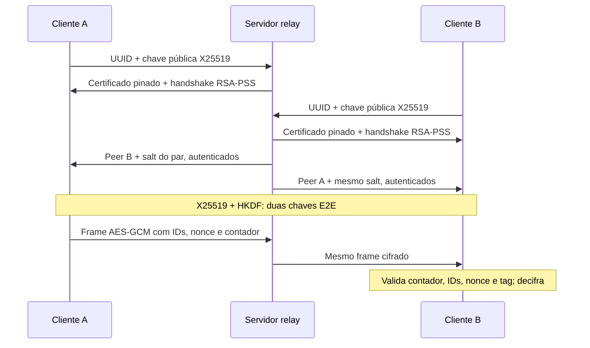

# Mensageria segura E2E multi-cliente

Trabalho Prático 3 de Segurança da Informação. Servidor TCP relay, autenticação RSA-PSS com certificado pinado e conversas ponta a ponta usando X25519, HKDF-SHA256 e AES-128-GCM.

O servidor recebe chaves públicas e encaminha frames cifrados. As chaves AES e a decifragem ficam nos clientes. A interface é de terminal, com envio e recebimento simultâneos.

## Comece por aqui

- [Guia da Pessoa 1: servidor, rede e autenticação](docs/estudo_pessoa_1.md)
- [Guia da Pessoa 2: cliente e criptografia E2E](docs/estudo_pessoa_2.md)
- [Roteiro da apresentação e demonstrações](docs/apresentacao.md)
- [Especificação do protocolo e decisões sobre o enunciado](docs/protocolo.md)
- [Testes e resultados de validação](docs/testes.md)

## Instalação

Ambiente validado: Python 3.12 em Linux. A CLI usa entrada assíncrona por pipe e tem como alvo Linux/macOS; Windows não foi validado. Execute todos os comandos a partir da raiz do repositório.

```bash
python3 -m venv .venv
.venv/bin/python -m pip install -r requirements-dev.txt
```

Para apenas executar o sistema, `requirements.txt` basta. O arquivo de desenvolvimento acrescenta as ferramentas de teste.

## Demonstração automática em um comando

```bash
.venv/bin/python -m scripts.demonstrar_falhas
```

O comando inicia seu próprio relay em uma porta local disponível e três clientes reais, executa os cenários e encerra tudo. Não depende de um servidor manual, de certificado em disco nem de acesso externo. Reutiliza os mesmos módulos do sistema interativo.

Saída esperada: `PASSOU E2E`, `PASSOU ADULTERAÇÃO`, `PASSOU REPLAY`, `PASSOU FRAMING`, `PASSOU RECONEXÃO` e `PASSOU PINNING`.

Para executar só uma parte:

```bash
.venv/bin/python -m scripts.demonstrar_falhas --cenario adulteracao
.venv/bin/python -m scripts.demonstrar_falhas --cenario replay
.venv/bin/python -m scripts.demonstrar_falhas --cenario framing
```

## Conversa interativa

Gere a identidade uma única vez:

```bash
.venv/bin/python -m scripts.gerar_certificado
```

Cria `certs/server.key` (privada, permissão 600) e `certs/server.crt` (certificado público). O script recusa sobrescrever arquivos existentes. Nesta pasta, a identidade local já foi gerada durante a validação; após um clone novo, execute o comando acima.

Em um terminal, inicie o servidor:

```bash
.venv/bin/python -m src.server.main
```

Em outros dois ou três terminais, execute em cada um:

```bash
.venv/bin/python -m src.client.main
```

Cada cliente mostra seu UUID e avisa quando peers entram ou saem. No primeiro cliente:

```text
/peers
/to 1
Olá, mensagem cifrada!
```

No destinatário, confira a recepção. Para responder, também use `/peers` e `/to 1`. Com três clientes, a numeração pode ser diferente em cada tela: identifique o destinatário pelo UUID mostrado ao lado do número.

| Comando | Ação |
|---|---|
| `/peers` | Lista os peers conectados e seus números |
| `/to NUMERO_OU_UUID` | Seleciona destinatário para as próximas linhas |
| `/send NUMERO_OU_UUID TEXTO` | Envia diretamente a um destinatário |
| `/id` | Mostra seu UUID |
| `/help` | Mostra a ajuda |
| `/quit` | Encerra o cliente |

O limite é de 4096 bytes UTF-8 por mensagem, não necessariamente 4096 caracteres. O servidor aceita, por padrão, até 20 conexões simultâneas, incluindo registros ainda em andamento.

## Configuração e reconexão

```bash
.venv/bin/python -m src.server.main --host 127.0.0.1 --port 8888 --max-clients 20
.venv/bin/python -m src.client.main --host 127.0.0.1 --port 8888 --cert certs/server.crt
.venv/bin/python -m src.client.main --id 00000000-0000-4000-8000-000000000001
```

Para testar mesmo UUID, encerre o cliente e repita o último comando. Há um novo handshake e novas chaves. Um UUID ainda ativo é recusado. Os caminhos de identidade do servidor podem ser definidos por `--key` e `--cert`.

Para usar computadores diferentes, configure o endereço do servidor e distribua previamente **somente o certificado público**, por um canal confiável. O pin é a comparação exata com o certificado configurado; receber outro certificado pela rede não cria confiança. A chave RSA privada fica no servidor. Certificados e chaves locais são ignorados pelo Git.

## Testes

```bash
.venv/bin/python -m pytest -q
```

A suíte usa TCP em `127.0.0.1`, portas efêmeras e subprocessos da CLI. Um ambiente que proíbe sockets locais precisa liberar essa execução. As demonstrações manipulam frames em memória sem imprimir ou persistir chaves, salts, nonces ou frames completos.

## Como funciona



## Garantias e limites

- Confidencialidade e integridade pelo AES-GCM; IDs/contador são autenticados pelo AAD.
- Autenticidade do servidor pelo certificado pinado e RSA-PSS; diretório e controles também são assinados.
- Replay E2E bloqueado no destinatário; replay administrativo bloqueado por contexto e contador.
- Comprometer futuramente a chave RSA não revela conversas passadas se os segredos efêmeros antigos tiverem sido descartados.
- O diretório pressupõe um servidor confiável. Não há verificação independente de identidades pessoais, proteção contra um servidor malicioso que substitua chaves nem ratchet por mensagem.
- A implementação não oculta IDs, tamanhos ou padrões de tráfego, não guarda histórico e não promete apagamento físico de memória em Python.

Logs do servidor contêm somente eventos, IDs, comprimentos e razões de rejeição. Conversas aparecem na interface dos clientes, sem serem gravadas como logs. O PDF original permanece apenas na pasta de trabalho e não é versionado.

A implementação e os materiais de estudo foram preparados com assistência do Codex. A divisão dos guias é para compreensão e apresentação do código completo.
